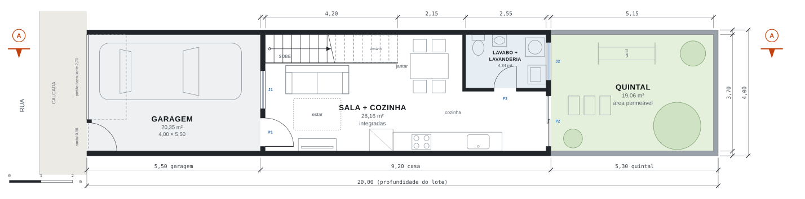
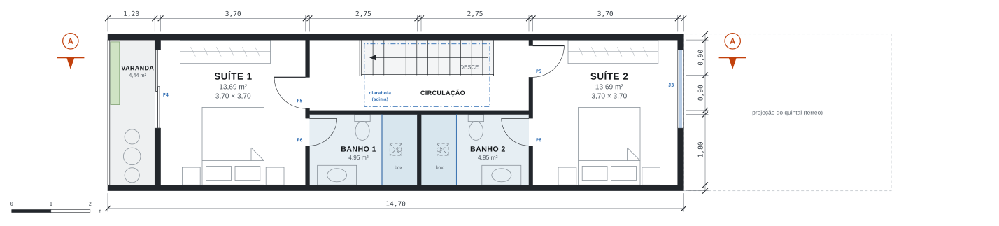

# Sobrado 4×20 — anteprojeto

Casa de dois pavimentos para um lote de **4,00 × 20,00 m**: duas suítes, sala e cozinha integradas, lavabo junto com a lavanderia e garagem coberta de **5,50 m** ocupando toda a frente do terreno.

**Área construída:** 117,60 m² · **Lote:** 80,00 m² · **Taxa de ocupação:** 73,5% · **Coef. de aproveitamento:** 1,47 · **Área permeável:** até 23,8%

## Programa pedido

- **Garagem de 5,50 m ocupando toda a frente** — Garagem coberta de 4,00 × 5,50 m (3,70 m livres entre paredes), com portão basculante de 2,70 m e portão social de 0,90 m. Cabe um carro de até 5 m, com espaço para abrir a porta e passar ao lado.
- **Sala e cozinha conjugadas** — Um só ambiente de 28,16 m² com estar, mesa para 4 e cozinha linear (3,45 m de bancada mais a geladeira), aberto para o quintal por uma porta de correr de vidro.
- **Lavabo junto com a lavanderia** — Ambiente único de 4,34 m² nos fundos com vaso, lavatório, tanque e máquina de lavar. A janela para o quintal garante ventilação natural.
- **Duas suítes** — No pavimento superior, duas suítes iguais de 3,70 × 3,70 m (13,69 m²), cada uma com banheiro de 4,95 m². A suíte da frente tem varanda de 4,44 m² sobre a garagem.

## Desenhos

As plantas estão com a rua à esquerda; plantas e corte usam a mesma escala e o mesmo eixo de profundidade, então podem ser lidos alinhados.

### Planta do térreo



### Planta do pavimento superior



### Corte AA


### Fachada frontal


## Quadro de áreas

| Ambiente | m² |
|---|---:|
| Térreo — Garagem (coberta) | 20,35 |
| Térreo — Sala + cozinha integradas (inclui escada) | 28,16 |
| Térreo — Lavabo + lavanderia | 4,34 |
| Superior — Varanda | 4,44 |
| Superior — Suíte 1 (quarto) | 13,69 |
| Superior — Banho suíte 1 | 4,95 |
| Superior — Circulação | 7,02 |
| Superior — Banho suíte 2 | 4,95 |
| Superior — Suíte 2 (quarto) | 13,69 |
| Quintal descoberto | 19,06 |
| Área útil (térreo + superior) | 101,59 |
| **Área construída** (térreo 58,80 + superior 58,80) | **117,60** |

## Como a casa foi resolvida

- **Por que sobrado.** Com 3,70 m livres de largura, o programa não cabe num pavimento só sem acabar com o quintal. No sobrado, o térreo fica com a parte social e o pavimento de cima com as suítes.
- **Paredes laterais sem janelas.** O Código Civil (art. 1.301) proíbe abrir janelas a menos de 1,5 m da divisa, e num lote de 4 m as duas paredes laterais estão na divisa. Por isso toda a luz entra pela frente, pelos fundos e por uma claraboia sobre a escada, que funciona como poço de luz para a sala e para a circulação.
- **Escada reta encostada na divisa.** A escada ocupa só 0,90 m de largura e deixa a sala livre. São 16 degraus com espelho de 18 cm e piso de 28 cm (2 × 18 + 28 = 64 cm, dentro da fórmula de Blondel) e guarda-corpo de 1,10 m. Embaixo do trecho mais alto há um armário.
- **Hidráulica concentrada.** O banheiro da suíte 2 fica sobre a bancada da cozinha e o da suíte 1 desce pela mesma parede, com um rebaixo de forro de gesso na sala para a tubulação. Cozinha, lavabo e lavanderia ficam nos fundos, perto da saída de esgoto.
- **Suíte sobre a garagem.** A suíte 1 e a varanda avançam sobre a garagem. Assim o carro fica coberto e sobram 5,30 m de quintal nos fundos para jardim, varal e área permeável.

## Quadro de esquadrias

| Cód. | Tipo | L × H (m) | Peitoril | Qtd. |
|---|---|---:|---:|---:|
| P1 | Porta de entrada, de giro | 0,90 × 2,10 | — | 1 |
| P2 | Porta de correr de vidro, 2 folhas (cozinha → quintal) | 1,60 × 2,10 | — | 1 |
| P3 | Porta de giro (lavabo + lavanderia) | 0,70 × 2,10 | — | 1 |
| P4 | Porta de correr de vidro, 2 folhas (suíte 1 → varanda) | 2,00 × 2,10 | — | 1 |
| P5 | Porta de giro (suítes) | 0,80 × 2,10 | — | 2 |
| P6 | Porta de giro (banheiros) | 0,70 × 2,10 | — | 2 |
| J1 | Janela de correr (sala → garagem) | 1,20 × 1,20 | 1,00 | 1 |
| J2 | Janela basculante (lavanderia) | 1,20 × 0,70 | 1,40 | 1 |
| J3 | Janela de correr (suíte 2) | 2,00 × 1,20 | 1,00 | 1 |
| PG | Portão basculante ripado | 2,70 × 2,40 | — | 1 |
| PS | Portão social ripado | 0,90 × 2,40 | — | 1 |

## Memorial resumido

- **Alturas.** Pé-direito de 2,70 m nos dois pavimentos e 2,88 m de piso a piso. Na garagem, 2,80 m livres sob a laje e 2,50 m sob a viga do portão. Altura total até a platibanda: 6,60 m.
- **Estrutura.** Concreto armado, com pilares embutidos nas paredes de divisa e lajes vencendo o vão de 3,70 m. Uma alternativa é alvenaria estrutural com blocos de 14 cm. O dimensionamento é do projeto estrutural, depois da sondagem do terreno.
- **Paredes.** Paredes de divisa e externas com 15 cm acabadas, internas com 10 cm.
- **Cobertura.** Laje de forro mais telha termoacústica com cerca de 10% de caimento, escondida pela platibanda e com calha interna. Claraboia de vidro laminado sobre a escada, de preferência com abertura para tirar o ar quente.
- **Ventilação dos banheiros.** Os banheiros do pavimento superior ficam no miolo da casa: ventilação por exaustor com duto até a cobertura ou por domus ventilado.
- **Iluminação.** As aberturas dos quartos e da sala ficam em torno de 1/6 da área de piso, a proporção que muitos códigos de obras pedem para ambientes de permanência prolongada; a claraboia complementa a sala. Confira o índice exigido no código do seu município.
- **Área permeável.** Quintal ajardinado e, se possível, piso drenante na garagem (concregrama ou intertravado permeável).

## Antes de construir, verifique

- **Recuo frontal.** Muitas prefeituras exigem recuo frontal de 4 a 5 m. A garagem cumpre esse papel no térreo, mas algumas cidades não permitem construir o pavimento superior sobre o recuo. Nesse caso, a casa precisa avançar sobre o quintal (que cai de 5,30 m para cerca de 1,50 m).
- **Índices urbanísticos.** Taxa de ocupação de 73,5%, coeficiente de aproveitamento de 1,47 e permeabilidade de até 23,8%. Compare com o zoneamento do lote.
- **Aprovação.** Este é um anteprojeto. Para construir, é preciso o projeto legal assinado por arquiteto ou engenheiro (RRT/ART), além dos projetos estrutural, elétrico e hidrossanitário.

## Arquivos

| Arquivo | Conteúdo |
|---|---|
| `projeto/prancha-a3.pdf` | Prancha única A3 em escala 1:100 (plantas, corte, fachada, quadros) |
| `projeto/sobrado-4x20.dxf` | Desenhos para CAD, em metros, separados por camadas |
| `projeto/*.svg` | Desenhos em vetor |
| `projeto/index.html` | Página de apresentação (tema claro e escuro) |
| `gerar_projeto.py` | Modelo paramétrico que gera todos os arquivos acima |

Para alterar o projeto, edite as coordenadas em `gerar_projeto.py` e rode:

```bash
pip install shapely ezdxf
python3 gerar_projeto.py   # o PDF usa node + playwright, se houver
```
