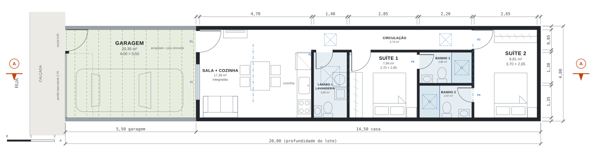
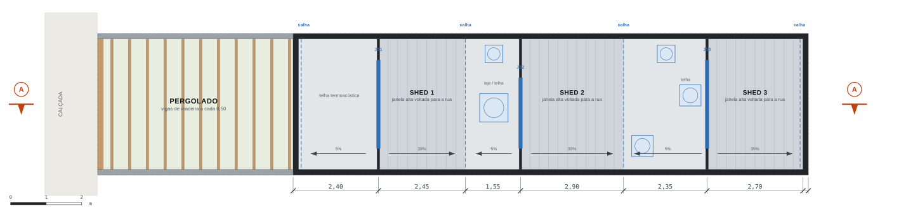
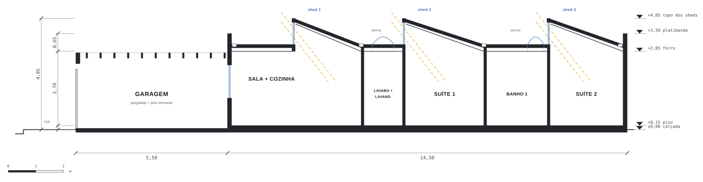
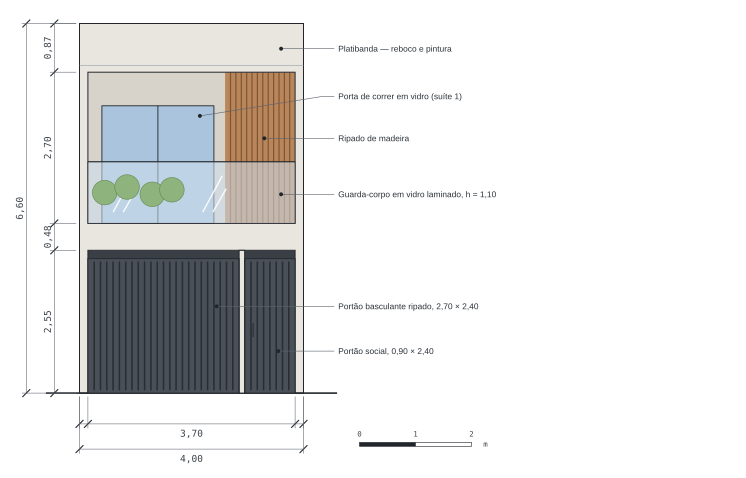

# Casa Térrea 4×20 — anteprojeto

Casa de **um pavimento** para um lote de **4,00 × 20,00 m**: duas suítes, sala e cozinha integradas, lavabo junto com a lavanderia e garagem de **5,50 m** ocupando toda a frente do terreno.

**Área construída:** 58,00 m² (+ garagem com pergolado) · **Área útil:** 50,45 m² · **Taxa de ocupação:** 72,5% · **Permeável:** até 25,4%

## Programa pedido

- **Garagem de 5,50 m ocupando toda a frente** — Garagem de 4,00 × 5,50 m (3,70 m livres entre os muros), com pergolado e piso drenante. Portão basculante de 2,70 m e portão social de 0,90 m. O carro fica à direita e a passagem para a porta de entrada, à esquerda.
- **Sala e cozinha conjugadas** — Um ambiente de 17,39 m² com estar, mesa para 4 e cozinha linear de 2,75 m (geladeira, pia e cooktop). Janela para a garagem e janela alta no shed sobre a cozinha.
- **Lavabo junto com a lavanderia** — Ambiente único de 3,85 m² logo depois da cozinha, com vaso, lavatório, tanque e máquina de lavar. Ventilação por domus no teto.
- **Duas suítes, tudo no térreo** — Suíte 1 com quarto de 7,84 m² e banheiro de 2,86 m². Suíte 2, no fundo, com quarto de 9,81 m² e banheiro de 2,97 m². Os dois banheiros ficam lado a lado, entre os quartos.

## Como os 20 m foram distribuídos

| Trecho | de (m) | até (m) | comprimento |
|---|---:|---:|---:|
| Garagem | 0,00 | 5,50 | 5,50 |
| Sala + cozinha | 5,65 | 10,35 | 4,70 |
| Lavabo + lavanderia | 10,45 | 11,85 | 1,40 |
| Suíte 1 (quarto) | 11,95 | 14,80 | 2,85 |
| Banheiros lado a lado | 14,90 | 17,10 | 2,20 |
| Suíte 2 (quarto) | 17,20 | 19,85 | 2,65 |

Entre os trechos há paredes de 10 a 15 cm; a parede do fundo termina exatamente em 20,00 m.

## Desenhos

As plantas estão com a rua à esquerda; plantas e corte usam a mesma escala e o mesmo eixo.

### Planta baixa



### Planta de cobertura



### Corte AA



### Fachada frontal



## Quadro de áreas

| Ambiente | m² |
|---|---:|
| Sala + cozinha integradas | 17,39 |
| Lavabo + lavanderia | 3,85 |
| Circulação | 5,74 |
| Suíte 1 (quarto) | 7,84 |
| Banho suíte 1 | 2,86 |
| Suíte 2 (quarto) | 9,81 |
| Banho suíte 2 | 2,97 |
| **Área útil da casa** | **50,45** |
| Garagem com pergolado (área aberta) | 20,35 |
| **Área construída** (casa 4,00 × 14,50) | **58,00** |

## Como a casa foi resolvida

- **O programa ocupa o lote inteiro.** Depois da garagem sobram 14,50 m de profundidade e 3,70 m livres de largura. Sala, lavabo, duas suítes e corredor cabem exatamente nesse espaço: a casa vai até o muro do fundo e não sobra quintal. Por isso os cômodos são compactos.
- **Luz e ar pelo telhado (sheds).** As paredes laterais estão na divisa e não podem ter janelas (Código Civil, art. 1.301), e o fundo encosta no vizinho. A sala, a cozinha e os quartos recebem janelas altas em sheds, voltadas para a rua. Essas janelas ficam perpendiculares às divisas e a mais de 0,75 m delas, distância que o § 1º do mesmo artigo exige.
- **Um corredor só.** Um corredor de 0,85 m na lateral esquerda liga a sala ao lavabo, à suíte 1 e à suíte 2. A suíte do fundo ocupa a largura toda porque o corredor termina na porta dela.
- **Banheiros lado a lado.** Os banheiros das duas suítes ficam lado a lado, cada um abrindo para a sua suíte. Assim eles dividem a parede hidráulica e ocupam 2,20 m de comprimento em vez de 2,90 m.
- **Garagem aberta com pergolado.** Sem laje, a garagem funciona como área aberta: ilumina a sala, pode contar como área permeável (com piso drenante) e normalmente não entra na taxa de ocupação.

## Quadro de esquadrias

| Cód. | Tipo | L × H (m) | Peitoril | Qtd. |
|---|---|---:|---:|---:|
| P1 | Porta de entrada, de giro | 0,90 × 2,10 | — | 1 |
| P2 | Porta de giro (lavabo + lavanderia) | 0,70 × 2,10 | — | 1 |
| P3 | Porta de giro (suítes) | 0,80 × 2,10 | — | 2 |
| P4 | Porta de giro (banheiros) | 0,60 × 2,10 | — | 2 |
| J1 | Janela de correr (sala → garagem) | 1,50 × 1,20 | 1,00 | 1 |
| JS1 | Janela alta basculante no shed 1 (sala e cozinha) | 2,50 × 0,80 | 2,95 | 1 |
| JS2 | Janela alta basculante no shed 2 (suíte 1) | 2,00 × 0,80 | 2,95 | 1 |
| JS3 | Janela alta basculante no shed 3 (suíte 2) | 2,50 × 0,80 | 2,95 | 1 |
| D1 | Domus ventilado (lavabo + lavanderia) | 0,80 × 0,80 | teto | 1 |
| D2 | Domus ventilado (banheiros e corredor) | 0,60 × 0,60 | teto | 4 |
| PG | Portão basculante ripado | 2,70 × 2,20 | — | 1 |
| PS | Portão social ripado | 0,90 × 2,20 | — | 1 |

## Memorial resumido

- **Alturas.** Pé-direito de 2,70 m. Sob os sheds, o forro acompanha a inclinação e sobe até cerca de 3,70 m junto à janela. Platibanda a 3,50 m e topo dos sheds a 4,05 m.
- **Estrutura.** Alvenaria estrutural de blocos de 14 cm ou concreto armado com pilares nas divisas. Cobertura em estrutura metálica leve com telha termoacústica. O dimensionamento é do projeto estrutural.
- **Paredes.** Paredes de divisa com 15 cm acabadas e internas com 10 cm.
- **Cobertura.** Trechos planos com 5% de caimento e sheds com cerca de 35%, sempre escoando para longe das janelas. Calhas nos pontos baixos, com descidas embutidas nas paredes de divisa.
- **Janelas dos sheds.** Basculantes de vidro entre 2,95 m e 3,75 m acima do piso, abertas por haste. Se a rua ficar ao norte, use vidro de controle solar ou brise; se ficar ao sul, a luz entra difusa.
- **Banheiros e lavabo.** Domus ventilado no teto e exaustor com duto até a cobertura.
- **Iluminação.** As aberturas da sala e dos quartos somam pelo menos 1/6 da área de piso, a proporção que muitos códigos de obras pedem para ambientes de permanência prolongada.
- **Área permeável.** Garagem com concregrama ou piso intertravado permeável.

## Antes de construir, verifique

- **Fundo e laterais na divisa.** A casa encosta nas duas laterais e no fundo. Algumas cidades exigem recuo de fundo ou área livre mínima no lote. Nesse caso, os cômodos precisam encolher ou volta a fazer sentido o sobrado.
- **Janelas em sheds.** A maioria dos códigos de obras aceita janelas altas voltadas para o céu como iluminação e ventilação. Confirme no código do seu município.
- **Garagem no recuo frontal.** Pergolado no recuo costuma ser permitido. Se a prefeitura deixar cobrir com policarbonato ou telha, a garagem passa a contar como área coberta.
- **Índices urbanísticos.** Taxa de ocupação de 72,5% e coeficiente de aproveitamento de 0,725, sem contar a garagem. A permeabilidade depende de a prefeitura aceitar o piso drenante da garagem (até 25,4%).
- **Aprovação.** Este é um anteprojeto. Para construir, é preciso o projeto legal assinado por arquiteto ou engenheiro (RRT/ART), além dos projetos estrutural, elétrico e hidrossanitário.

## Arquivos

| Arquivo | Conteúdo |
|---|---|
| `projeto/prancha-a3.pdf` | Prancha única A3 em escala 1:100 (planta, cobertura, corte, fachada, quadros) |
| `projeto/casa-terrea-4x20.dxf` | Desenhos para CAD, em metros, separados por camadas |
| `projeto/*.svg` | Desenhos em vetor |
| `projeto/index.html` | Página de apresentação (tema claro e escuro) |
| `gerar_projeto.py` | Modelo paramétrico que gera todos os arquivos acima |

A primeira versão (sobrado de dois pavimentos) está no histórico do git, no commit `9a2be4c`.

Para alterar o projeto, edite as coordenadas em `gerar_projeto.py` e rode:

```bash
pip install shapely ezdxf
python3 gerar_projeto.py   # o PDF usa node + playwright, se houver
```
